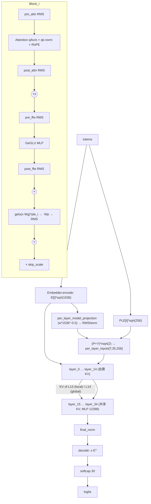

# 01 架構：Gemma 4 E2B（JAX 原始碼 + HF 權重）

> 原始碼：`src/gemma`（commit `9e1f741`）。以下路徑皆相對於 `src/gemma/gemma/`。
> 標記：✅ = 讀碼或數值實測確認；⚠️ = 推論 / 未實際執行模型驗證。

## 1. 設定值（Gemma4_E2B）

| 參數 | 值 | 出處 |
|---|---|---|
| 層數 | 35 | `gm/nn/gemma4/_gemma4.py:28`, `:133` ✅ |
| 注意力型態 | 每 5 層 `[L,L,L,L,G]` 重複 → global 在 4,9,14,19,24,29,34 | `_gemma4.py:125-134`、`gm/nn/gemma4/_config.py:41-52` ✅（HF `layer_types` 一致） |
| embed_dim (width) | 1536 | `_gemma4.py:137` ✅ |
| hidden_dim (MLP) | 1536×4 = 6144 | `_gemma4.py:33`, `:93` ✅ |
| KV 共享層 MLP | 6144×2 = 12288（`override_kv_shared_ffw_hidden`） | `_gemma4.py:115-117`, `_transformer.py:638-646` ✅ |
| q heads / kv heads | 8 / 1（MQA；`use_gqa` 為 False 因 kv=1） | `_gemma4.py:138-139`, `_modules.py:217-219` ✅ |
| head_dim local / global | 256 / 512（`global_key_size`） | `_gemma4.py:32`, `:95`, `:103`; `_modules.py:507-514` ✅ |
| sliding window | 512（雙向判斷 `|Δpos| < 512`，再乘因果遮罩） | `_gemma4.py:144`, `_modules.py:38-52`, `:340-351` ✅ |
| RoPE | local θ=1e4 全維；global θ=1e6、proportion 0.25 | `_gemma4.py:105-110`, `_transformer.py:182-187` ✅ |
| global RoPE 細節 | `rope_angles=int(0.25*512//2)=64`，頻率指數用 `2/head_dim(512)`，其餘 192 對 timescale=∞（不轉）＝ HF `proportional` | `gm/math/_positional_embeddings.py:47-58` ✅ |
| attn logits softcap | None；**無 1/√d 縮放**（q/k 已經 RMSNorm） | `_gemma4.py:107`, `_modules.py:265-334` ✅ |
| final logit softcap | 30.0：`tanh(logits/30)*30` | `_gemma4.py:97`, `_transformer.py:334-336` ✅ |
| QK norm | query_norm/key_norm 帶 scale；value_norm 無 scale | `_modules.py:236-238` ✅ |
| post attn / post ffw norm | 皆啟用 | `_gemma4.py:146-147` ✅ |
| vocab | 262144，embedding 與 lm_head 綁定（decode = x·Eᵀ） | `_gemma4.py:91`, `_modules.py:127-137` ✅ |
| PLE | per_layer_input_dim=256，表 `[262144,35,256]` | `_gemma4.py:141`, `_modules.py:100-110` ✅ |
| KV 共享 | `frac_shared_layers=20/35` → 前 15 層自算 KV；15-34 層：global 用 layer 14、local 用 layer 13 | `_gemma4.py:142`, `_config.py:55-84`, `_transformer.py:360-366` ✅ |
| text_only 預設 | True（建構時移除 vision/audio encoder） | `_gemma4.py:44`, `:50-60` ✅ |
| 多模態 | vision `VisionEncoder(use_clipped_linears=True)`、audio `ConformerConfig()` | `_gemma4.py:149-150` ✅ |

KV 共享計算（`_config.py:65-83`）：`num_unshared = int(35 - 20/35*35) = 15`；i≥15 時 global→`14`，local→`13`。✅

## 2. 各層公式

記號：`RMS(x)=x·rsqrt(mean(x²)+1e-6)`，RMSNorm **直接乘 w（不是 1+w）**（`_layers.py:93-117`；數值實測 HF 也是存 w，見 04）。✅

### 2.1 嵌入（`_modules.py:112-125`, `:169-198`）
```
x0 = E[t] * sqrt(1536)                                   # encode
P  = RMS_w( einsum('td,dnp->tnp', x0, W_plp * 1536^-0.5) )  # per_layer_model_projection, w_scale
Y  = PLE[t] * sqrt(256)                                   # [T,35,256]
per_layer_inputs = (P + Y) * 2^-0.5                       # rsqrt(2)
```
- `W_plp` 的 `w_scale=1536^-0.5` 是在 forward 時乘上（`_modules.py:106-109`, `_layers.py:45-46`），orbax 存的是未縮放值。✅（HF 端是否已預乘見 04 §4）

### 2.2 Block（`_modules.py:593-664`）
```
h  = RMS_w(x)                                   # pre_attention_norm
a  = Attn(h)                                    # 見 2.3
a  = RMS_w(a)                                   # post_attention_norm
x1 = x + a
f  = RMS_w(x1) → MLP → RMS_w(·)                 # pre_ffw_norm / post_ffw_norm
x2 = x1 + f
g  = gelu(x2 · W_gate[D,256]) * per_layer_inputs[:, i, :]
x3 = x2 + RMS_w(g · W_proj[256,D])              # post_per_layer_input_norm
out = x3 * skip_scale                           # [1] 純量（HF layer_scalar）
```

### 2.3 Attention（`_modules.py:242-397`）
```
q = RMS_w(einsum('BTD,NDH->BTNH', h, Wq)); q = rope(q)
k,v = einsum('BSD,CKDH->CBSKH', h, Wkv); k = RMS_w(k); v = RMS(v)  # v 無 scale
if 共享層: k,v = cache_of(layer 13/14)   # 仍會計算本層 kv_einsum 再丟棄（:275-287）
else: k = rope(k)
logits = einsum('BTNH,BSNH->BTNS', q, k)       # 無縮放
mask：因果 ∧ (local 時 sliding window)
o = einsum('BTNH,NHD->BTD', softmax(logits) , v)
```
⚠️ 第 275-276 行註解：共享層仍有 kv_einsum 參數（orbax 與 HF it 版都存在），但 HF QAT 版已刪除 15-34 層的 k_proj/v_proj/k_norm（見 04）。

### 2.4 MLP（`_modules.py:422-465`）
```
gate = einsum('...F,NHF->...NH', x, Wg[2,hidden,D])
y = gelu(gate[...,0,:]) * gate[...,1,:]          # nn.gelu 預設 approximate=True ＝ HF gelu_pytorch_tanh
out = einsum('...H,HF->...F', y, Wl[hidden,D])
```
參數名 `gating_einsum`、`linear` 用 `nn.share_scope` 直接掛在 mlp 下（`:446-460`）。✅

### 2.5 輸出（`_transformer.py:332-336`, `:389`）
`final_norm` → `logits = x·Eᵀ` → softcap 30。✅

## 3. Forward 流程圖



## 4. 參數分解（HF 標頭實算，元素數）

| 群組 | 張量數 | 參數 | bf16 GB |
|---|---|---|---|
| PLE `embed_tokens_per_layer` [262144, 8960] | 1 | 2,348,810,240 | 4.698 |
| 文字 MLP（35 層；15-34 層 hidden=12288） | 105 | 1,557,135,360 | 3.114 |
| `embed_tokens`（綁定 lm_head） | 1 | 402,653,184 | 0.805 |
| 音訊塔 + embed_audio | 752 | 307,184,384 | 0.614 |
| 文字 attention q/k/v/o | 140 | 297,271,296 | 0.595 |
| 視覺塔 + embed_vision | 659 | 168,544,704 | 0.337 |
| 每層 PLE gate/proj | 70 | 27,525,120 | 0.055 |
| PLE 全域投影 + norm | 2 | 13,762,816 | 0.028 |
| norms / 純量 | 281 | 291,875 | 0.001 |
| **合計** | **2011** | **5,123,178,979** | **10.246** |

- 文字部分 ≈ 4.647B；扣掉 PLE 表後 ≈ 2.30B（＝官方「有效 2.3B」）。✅
- MLP 驗算：15×3×6144×1536 + 20×3×12288×1536 = 424.7M + 1132.5M = 1557.1M ✅
- 3GB 目標的核心：PLE 表單獨佔 bf16 4.70GB；Q4_0（4.5 bit/參數）後約 1.32GB。⚠️ 只留文字、全部 Q4_0 估計 4.647B×0.5625 ≈ 2.61GB（估算，未實際打包）。
